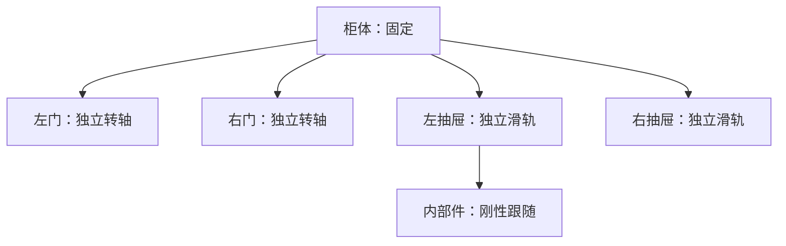

# 45194：冻结形状、用门/抽屉先验修正运动分组

已完成一次显式先验修正并生成重建视频。**原始形状、初始装配姿态和外观保持不变；两扇门由共用一根轴改为各有独立铰链，两个抽屉也可独立运动。**

## 视频

- [先验修正后的重建视频：双视角开合](/root/autodl-tmp/PAct/repro/outputs/semantic_motion_prior_45194_20261028_v1/45194_semantic_prior_reconstruction.mp4)
- [两扇门和两个抽屉逐个独立运动](/root/autodl-tmp/PAct/repro/outputs/semantic_motion_prior_45194_20261028_v1/45194_doors_drawers_independent.mp4)
- [原版与先验修正对比：左原版、右修正](/root/autodl-tmp/PAct/repro/outputs/semantic_motion_prior_45194_20261028_v1/45194_original_vs_semantic_prior.mp4)


## 根因与对先前解释的更正

直接检查最初 PAct 原始 Mesh，预测 `node 0 / door` 内有两个互不连通的大分量：左门片 20,558 顶点、41,112 面，右门片 20,578 顶点、41,152 面。它们被同一个部件 ID 绑定到同一个左侧铰链，因此右门会绕左门轴一起转。

之前根据输入 mask 与生成节点的对应关系，把“GT 第二扇门对应 fixed 根节点”解释为“实际几何中的第二扇门没有运动轴”，这个解释不准确。输入语义对应已经与生成几何分组不一致，不能直接当作几何事实。此次实际连通分量检查确认：**左右门都在 node 0；真正的问题是两个门片共用一个运动组。**

重力试验的零残差和类型歧义结论仍成立，但仅改轴方向无法修复这个运动分组错误。

## 本次采用的先验

| 部件 | 运动先验 | 与柜体/其他部件的关系 |
| --- | --- | --- |
| 柜体 | fixed | 固定根节点 |
| 左门 | revolute，独立竖直轴 | 连接柜体，铰链靠左外侧边缘 |
| 右门 | revolute，独立竖直轴 | 连接柜体，铰链靠右外侧边缘 |
| 左抽屉 | prismatic，沿前方 +Z | 独立连接柜体 |
| 右抽屉 | prismatic，沿前方 +Z | 独立连接柜体，与左抽屉滑轨平行 |
| 左抽屉内部件 | 相对抽屉 fixed | 跟随左抽屉，不再沿自己的预测行程漂移 |

这次“柜子各自运动”按左右柜门、左右抽屉分别控制处理；柜体本身仍固定。

运动树为：



先将原 `node 0` 的两个连通分量分别绑定到左右门运动组。Gaussian 按撤销已知序列化旋转后的坐标，匹配最近 Mesh 顶点的连通分量；没有重新生成或重新分割形状。原 `node 4` 完整包含在原左抽屉 `node 2` 的 AABB 内，按内部件先验绑定到左抽屉，其原始几何也没有移动或删除。

这是一项针对本案例、明确指定结构的先验验证；没有假称训练出了通用的自动语义分类器。仅知道一个部件被标注为 door 还不够，必须先区分不同的门实例。

## 两根门轴在哪里

坐标仍为 PAct Mesh/JSON 规范坐标：Y 竖直、+Z 朝柜体前方。两根轴方向均为 `(0,1,0)`。

| 门 | 轴原点（模型归一化坐标） | 示例角度区间 |
| --- | --- | --- |
| 左门 | `(-0.438017, -0.181713, 0.234158)` | `0 → -43.1352°` |
| 右门 | `(0.435284, -0.177705, 0.234268)` | `0 → +43.1352°` |

轴的位置由每个门片的水平主方向估计：选外侧的 1%/99% 投影端点作为铰链候选，竖直位置取门片中位数，仅是同一竖直轴上的参考点。与柜体表面的中位距离分别约 0.0133、0.0152 模型单位，用于记录连接接近程度；没有声称它们是标定的机械铰链中心。

左右角度幅度沿用原版门的预测幅度，按左右外侧铰链设置相反符号。两个抽屉的行程幅度分别保留原版预测的 0.464709、0.442099 模型单位；滑轨方向按先验统一为 +Z。视频从生成的现有初始姿态继续运动，不代表真实机械的完全关闭/最大开启区间。没有读取 GT 关节、GT 范围或追踪原视频来选择这些参数。

## 冻结几何与独立性核验

本轮只新增运动分组索引和关节元数据，原文件仅被引用：

- 原始 5 个 Mesh 和 5 个 Gaussian PLY 的 SHA256 全部保持一致。
- 每个原顶点、原面、原 Gaussian 都恰好属于一个运动组；没有丢弃、复制、平滑、补洞或形变。
- 没有面跨越运动组。两门的原分量本来互不连通，因此不需要切割三角面。
- 初始姿态最大差异为 0；41 状态下抽样刚体距离最大误差为 1.11e-16 模型单位。
- 单独驱动任一门/抽屉时，其余独立部件的变换泄漏为 0；左抽屉内部件与左抽屉变换完全相同。
- 各点竖直坐标变化为 0，因此仍满足固定负 Y 重力下的理想中性平衡先验。
- 三个 MP4 均解码验证首尾帧，人工查看了运动终点与右门独立运动关键帧。

渲染沿用原始 Gaussian 顺序与固定 DC 外观，避免同深度点因重排而产生无关图像变化。

本次完成的是运动分组和关节结构修正，不是神经网络训练。没有进行完整接触/碰撞仿真，也没有实测机械行程。重分组后原输入节点对应不能直接用于 GT 类型准确率，因此本轮不沿用此前的 3/4 指标来证明成功。结构改善由两根独立门轴、独立运动视频及冻结几何核验支持。

进一步自动化时，应先生成/修正部件实例和父子关系，再用语义限制候选关节类型，结合连接位置选择轴线，最后以重力和碰撞约束排除不合理运动。单独增加重力 Loss 无法代替门实例拆分。

## 文件与复现

结果目录：[semantic_motion_prior_45194_20261028_v1](/root/autodl-tmp/PAct/repro/outputs/semantic_motion_prior_45194_20261028_v1)。

[运动组与轴参数](/root/autodl-tmp/PAct/repro/outputs/semantic_motion_prior_45194_20261028_v1/motion_groups.json)、[索引成员表](/root/autodl-tmp/PAct/repro/outputs/semantic_motion_prior_45194_20261028_v1/membership.npz)、[核验与视频信息](/root/autodl-tmp/PAct/repro/outputs/semantic_motion_prior_45194_20261028_v1/verification.json)。

新增格式为运动组元数据及原几何索引，不伪装成能直接表达子集绑定的原生 PAct object.json。后续导出器需支持这些索引或将它们无损写为独立链接资产。

```bash
cd /root/autodl-tmp/PAct
PYTHONDONTWRITEBYTECODE=1 OMP_NUM_THREADS=4 /root/autodl-tmp/conda_envs/pact/bin/python \
  repro/tools/semantic_motion_prior_45194.py \
  --run repro/outputs/gt_45194_20261025T131221Z \
  --root /tmp/45194_semantic_prior_new --render
```
