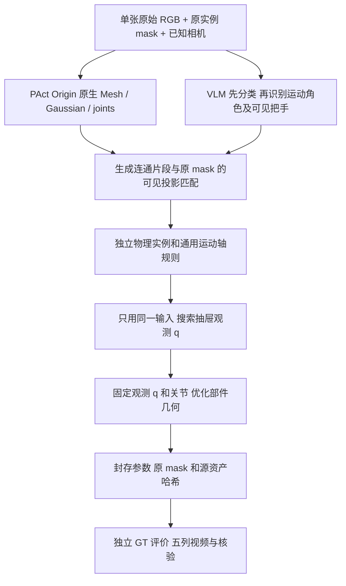

# v0.1.0-auto-semantics-pose

发布日期：2026-10-30。发布分支：`research/auto-semantics-pose-20261030`。
本次整理前的本地基线 commit：`2faf8c7`。源码文件及 SHA-256 见[版本清单](v0.1.0-auto-semantics-pose.manifest.json)。

这是目前实际运行过的自动化研究流程快照。保留旧工具作为运行依赖，不将其中的历史人工框、额外关闭图实验或失败结果包装成当前默认流程。原版 PAct 生成权重和推理算法没有因本轮后处理而重新训练。

## 验证范围

| 模块 | 当前已验证范围 | 本地结果目录（不随 Git 发布） |
|---|---|---|
| VLM 分类、物理部件分组和把手位置优先轴修复 | 11 case | `repro/outputs/auto_component_axis_priors_20261029_v7` |
| 自动实例、原输入 mask、固定 q0 几何优化 | 同一 11 case | `repro/outputs/vlm_component_geometry_20261029_v1` |
| 先估计观测位移，再优化几何；人工/VLM 两分支及 q0 消融 | **仅 20411** | `repro/outputs/observed_drawer_pose_20261029_v1` |

11 个 case：100481、101808、10489、10655、20411、31249、45194、45503、8961、9016、103015。
目前不能据此声称观测位移流程已在全部 11 个 case 验证。代码只搜索 prismatic 关节的输入观测位移；revolute 的观测角度仍固定为 q0。

## 1. 输入与 Origin 的准确含义

Origin 输入为原始 RGBA 和单独的实例 mask（`*_processed.png`、`*_mask.exr`）。实例 mask 只标部件编号/边界，loader 生成 RGB 条件、mask 条件和部件数；不向 Origin 输入“门/抽屉”类别文字、VLM 输出或人工轴规则。

本地复现实验现有 mask 来自 GT 网格投影的 oracle 2D 分割。准确设置是 **单张 RGB＋给定实例 mask**，不是纯 RGB、无需标注的完全自动分割。VLM 在原 mask 上识别语义，不重画边界、不手选新区域。

20411 的真实输入是抽屉打开的 `05_pure.png`，而原生生成模型接近关闭参考姿态。**生成参考 q0 不能直接等同于输入图的观测状态。** 旧实验使用的 `00_pure.png` 是另一张关闭图，当前单图拟合禁止读取它。

## 2. 当前处理流程



### A. 原 mask 上识别语义

`recognize_semantics_two_stage.py` 先从整物体背景图和原 mask 隔离区域识别整个部件类别，再独立推断运动角色、父部件和可见连接边；类别结果先封存。门板连同附着把手属于一扇门，不能仅因把手显眼就把整个门板标为 handle。

类别包含 body/base、door、drawer、handle、wheel、knob、shelf、tray、unknown。保存模型原始回答、解析结果、图片与提示词哈希。解析失败或证据不足会记录 unknown，不人工补成期望类别。

本版本使用本地 **Qwen/Qwen3-VL-4B-Instruct**，固定 revision：
`ebb281ec70b05090aa6165b016eac8ec08e71b17`。模型元数据见[模型清单](v0.1.0-auto-semantics-pose.model.json)。

### B. 连接证据、部件归属和轴修复

`auto_component_axis_prior.py` 将生成 mesh 的连通片段与原实例 mask 匹配：可见 Gaussian 投影投票、遮挡过滤、低置信度回退。同一物理实例的片段共享运动，不同门/抽屉/提手保持独立关节，避免两扇门共用一根轴。

轴是**通用规则与生成几何**的计算结果，不让 VLM 直接输出数值轴，也不使用 GT 轴：

- 抽屉：采用前后平移族。
- 侧开门：由叶片边缘、柜体连接/接近关系确定侧铰链。
- 搬运提手：需要两处支持/连接证据；固定在门、抽屉上的拉手随父部件运动。
- 宽扁的上下翻门候选：先看可见把手位置。下部把手→上沿铰链；上部把手→下沿铰链。高置信度定位框中心须落在原目标 mask，位置在门板上35%或下35%才采用；中部、不可见或不可靠时回退到柜体上/下位置规则。侧开门不走这条上下翻转分支。

上下边轴再由生成门板对应边缘和柜体接近点拟合。unknown、弱匹配片段可保留原生预测并记录原因；这不是可靠性保证。比如101808中规则变化的轴位置有退化，不根据GT再改单例。

轴阶段保留原始 mesh/Gaussian，仅改变物理分组、关节/轴。沿用兼容原预测行程；原先 fixed 等不兼容情况可能使用明确标记的假设区间，不可称为学习到真实限位。

### C. 单图估计观测位移

`fit_observed_drawer_pose.py` 在几何固定时，沿每条已有 prismatic 轴估计输入照片对应的 q：原预测区间内49点搜索，再做局部有界一维细化，2轮坐标搜索。目标只来自原始 RGB、轮廓和原实例 mask。

这三个量必须分开：

| 量 | 意义 | 当前版本 |
|---|---|---|
| 轴 | 允许沿哪条线/方向运动 | 先验阶段确定，随后冻结 |
| 观测 q | 输入照片里当前拉出多少 | 单图估计，然后冻结 |
| 机械区间 | 能运动到的起止限位 | 保留原预测，不优化 |

人工分支只沿用已有人工类别/物理归属和规则轴；不是人工填入GT轴坐标。VLM分支使用封存的自动语义、自动归属和轴。20411两分支给出相同的滑轨，因此本次没有证明VLM优于人工。

### D. 固定观测姿态后优化几何

人工/VLM两条分支从同一原生资产起步，不复用旧拟合几何；共用同一原mask、相机、冻结的RGB/轮廓配准、损失、形变范围和优化器。每个物理实例的所有片段共享形变参数；没有人工框、手绘多边形或人工左右配对。

目标：`RGB weighted L1 + 2*silhouette L1 + 0.5*instance Dice + 0.1*interior CE + 0.002*log_shape² + 0.01*shift²`。

- 几何优化240步Adam，shape学习率0.012，shift学习率0.004。
- 保留原有有界形变：铰链锚定径向宽度形变、面内缩放及有限位移。冻结颜色、透明度、点数、拓扑、关节类型/轴/父子关系/机械区间。
- 观测位移版保存**训练目标最小**的状态；不按GT或其他图挑checkpoint。此前11-case固定q0版本展示最终240步，两者checkpoint政策不同，报告中明确区分。
- 两条分支分别运行 q=0 直接几何、估计观测q后几何两个对照；本轮新增位移的收益在相同训练最优政策下比较。

当前没有完整的门板覆盖柜口、自动左右对称约束，也没有重力/动力学稳定性求解。优化可能因遮挡/梯度失稳而退化；10489在固定q0版本即有明确退化。训练最优保护不等于解决所有渲染梯度问题或恢复正确隐藏结构。

### E. 封存后评价和视频

所有候选拟合先封存，之后独立读取GT网格/轴做评价。相机/固定体对齐不按各候选重新拟合，不用GT选择轴、观测位移、几何或checkpoint。

- 输入IoU：前景轮廓阈值0.5；实例mIoU是训练mask诊断，不是新视角准确率。
- 表面CD：双向非平方表面距离均值，除以GT固定体对角线D；不叫实体体积IoU。
- 完整轴标准：独立且类型正确，方向≤5°，转轴位置≤5%D；平移轴原点不评价。
- 20411没有同类新相机集合，不填造新视角指标。报告输入姿态CD、关闭参考形状CD和保留原行程的六状态CD。
- 五列视频为 **GT → Origin → VLM轴 → VLM轴＋观测位移＋几何 → 人工轴＋观测位移＋几何**。视频保留原预测完整行程；另有静态输入姿态图显示估计q。共同播放进度不等于预测和GT行程数值相同。

## 3. 本版已验证结果

### 20411：先观测位移，再几何

拟合只使用打开的05输入。两分支估计q均为 **0.28496 原模型单位**，没有用真实关闭图监督。

| 方法 | 输入IoU % | 实例mIoU % | 输入姿态表面CD %D ↓ |
|---|---:|---:|---:|
| Origin | 76.36 | 70.33 | 3.462 |
| VLM轴 | 76.36 | 70.33 | 3.462 |
| VLM轴＋几何，固定q0 | 81.36 | 77.30 | 3.848 |
| VLM轴＋仅观测位移 | 87.36 | 83.71 | 2.444 |
| VLM轴＋观测位移＋几何 | 90.45 | 89.75 | 1.988 |
| 人工轴＋观测位移＋几何 | 90.45 | 89.75 | 1.987 |

输入姿态CD包含姿态与形状误差。独立查看不施加观测q的关闭参考形状CD，Origin为2.482%D，VLM几何为2.088%D、人工几何为2.086%D。完整原行程下六状态平均CD为2.720→2.265/2.263%D。轴方向0.636°→0°，严格标准均为1/1；几何阶段没有再优化轴。

### 前序11-case结果的界限

v7自动轴为26/27类型正确、15/27完整轴正确。45503下方门已变为上沿铰链，但轴位置仍约11.74%D，未通过5%D位置标准。固定q0几何版输入IoU均值83.89%→85.86%，表面CD3.90→4.06%D，存在平均三维退化。不能用20411新结果改写这11-case历史成绩。

历史`closed_multicase_20261028_v1`使用额外关闭RGB和人工框，监督条件不同。它不是当前单图设置的公平主结果，也不作为默认拟合输入。

## 4. 运行与依赖

### 环境与数据前提

保留现有PAct GPU环境及官方依赖。已验证的本地关键版本：PyTorch2.4.0（CUDA12.1）、NumPy1.26.4、SciPy1.14.1、trimesh4.5.3、Pillow10.4.0、nvdiffrast0.4.0、本地编译的diff-gaussian-rasterization。VLM使用独立环境的transformers4.57.6；不要为运行VLM直接覆盖原PAct环境的transformers4.50.3。

需要已准备的输入RGBA、原实例EXR、已知相机、原生PAct导出Mesh/GS/joint JSON、input provenance及配准缓存。版本不包含权重、数据、视频、拟合checkpoint和虚拟环境。**这些命令是依赖齐全后的研究流程回放，不是全新clone即可从空目录一键运行。**

当前路径默认引用`repro/outputs/general_semantic_priors_20261029_v2`、`auto_component_axis_priors_20261029_v7`、`vlm_component_geometry_20261029_v1`。跨机器运行需要迁移/重建先验与缓存，核对其JSON中的绝对路径。人工对照和部分历史finalizer也依赖这些已有实验目录；当前尚未封装为无历史缓存依赖的通用产品。

### 原 mask 上重新识别语义与把手

示意命令中的目录必须是新目录；`input_inventory.json`每项至少包含`case`、`run`、`provenance`、`mask`、`rgb`，都指向真实已有输入。Qwen本地目录需包含固定模型文件和`pinned_download_metadata.json`，不能将下载器默认的其他模型当成本版模型。

```bash
export PYTHONDONTWRITEBYTECODE=1
export OPENCV_IO_ENABLE_OPENEXR=1
export OMP_NUM_THREADS=4
PY=/root/autodl-tmp/conda_envs/pact/bin/python
VLM_PY=/root/autodl-tmp/PAct/repro/envs/auto_semantics/bin/python

"$PY" repro/tools/recognize_semantics_two_stage.py \
  --stage prepare --inventory /path/to/input_inventory.json \
  --root repro/outputs/auto_semantics_REPLAY \
  --model repro/cache/Qwen3-VL-4B-Instruct
"$VLM_PY" repro/tools/recognize_semantics_two_stage.py \
  --stage recognize --root repro/outputs/auto_semantics_REPLAY \
  --model repro/cache/Qwen3-VL-4B-Instruct

"$PY" repro/tools/recognize_door_pulls.py \
  --stage prepare --source repro/outputs/auto_semantics_REPLAY \
  --root repro/outputs/auto_pulls_REPLAY
"$VLM_PY" repro/tools/recognize_door_pulls.py \
  --stage recognize --root repro/outputs/auto_pulls_REPLAY \
  --model repro/cache/Qwen3-VL-4B-Instruct

"$PY" repro/tools/build_pull_guided_axes.py \
  --root repro/outputs/auto_axes_REPLAY \
  --auto-root repro/outputs/auto_pulls_REPLAY \
  --registration-root repro/outputs/general_semantic_priors_20261029_v2
```

最后一步生成`AXIS_CANDIDATES_SEAL.json`，之后才评价。`evaluate_auto_component_axes.py`接受`--root`和`--reference-root`；`render_auto_component_three_views.py`接受相同参数及可选`--case`。历史`render_pull_guided_axes.py`/`finalize_pull_guided_axes.py`另需旧v6比较基线及完整性记录，不要把它们当成没有依赖的一键封存工具。

### 回放已经验证的20411人工/VLM观测位移对照

先准备上述已封存先验与当前默认依赖目录；本入口不会重新生成Origin，也不会自动运行前序VLM阶段。

```bash
"$PY" repro/tools/fit_observed_drawer_pose.py \
  --root repro/outputs/observed_drawer_pose_REPLAY --cases 20411
"$PY" repro/tools/evaluate_observed_drawer_pose.py \
  --root repro/outputs/observed_drawer_pose_REPLAY
"$PY" repro/tools/render_observed_drawer_pose.py \
  --root repro/outputs/observed_drawer_pose_REPLAY
"$PY" repro/tools/finalize_observed_drawer_pose.py \
  --root repro/outputs/observed_drawer_pose_REPLAY
```

`fit_observed_drawer_pose.py`会分别prepare两条分支，先封存两条分支全部拟合，再允许独立GT评价。不要对已封存结果目录修改参数后继续跑，也不要把已生成marker当作新实验完成的证据。

固定q0自动几何基线入口为`fit_vlm_component_geometry.py --root <新目录> --axis-root <已完整封存轴目录>`。该入口要求轴目录已有`FINAL_SEAL.json`，仅有候选轴seal时还不能直接继续。

### 输出结构

```text
<experiment>/
  protocol.json, controller_status.json, metrics.csv, summary.json
  origin_input_audit.json, VERIFICATION.json, FINAL_SEAL.json, REPORT.md
  source_snapshot/
  20411/
    vlm/    # 原mask、轴、观测q、q0/观测q几何对照、训练历史和导出资产
    human/  # 同一训练设置的人工先验对照
    evaluation.json
    five_versions_input_pose.png, pose_ablation.png
    20411_GT_Origin_VLMAxis_VLMPoseGeo_HumanPoseGeo.mp4
```

`optimized_asset`保存原生参考坐标下的几何；观测q单独记录，不烘焙进机械区间。manifest/观测/mask/源资产哈希、全部视频解码和GT读取隔离由finalizer检查。

## 5. 代码核验

在已配置PAct环境、仓库根目录执行：

```bash
PYTHONPATH=repro/tools PYTHONDONTWRITEBYTECODE=1 "$PY" -m unittest \
  test_auto_semantic_axes test_semantic_motion_rules test_door_pull_priority \
  test_vlm_component_geometry test_observed_drawer_pose
```

测试覆盖结构化VLM输出、角色/连接规则、把手位置优先级、自动实例形变归属和观测q的FK/范围隔离。GPU重建和视频的实验核验另见本地各版`VERIFICATION.json`；单元测试通过不代表所有案例重建正确。
